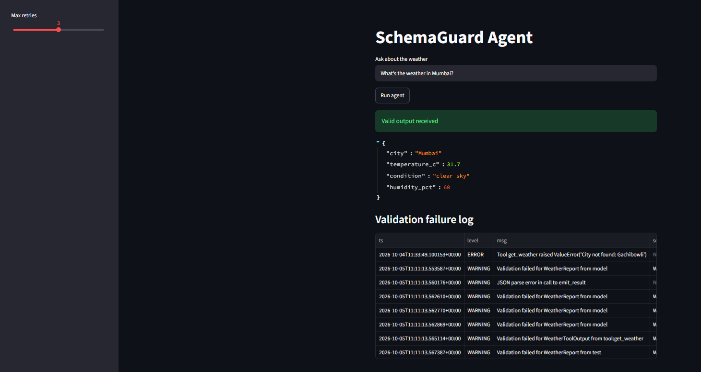
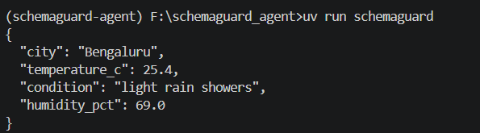
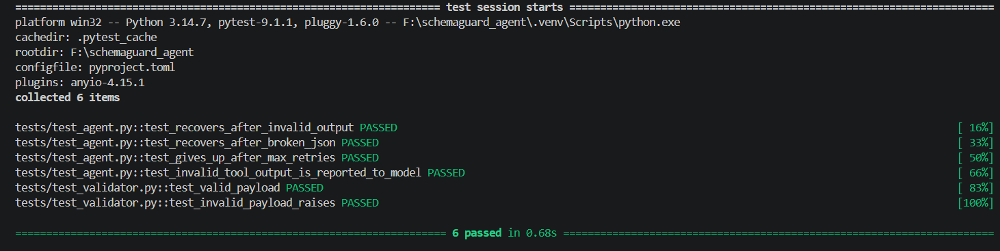

# Structured Output Agent

An LLM agent that guarantees **schema-valid output**. Every model answer and every tool response is validated with Pydantic. Failures are logged, sent back to the model, and retried automatically.



## Features

- **Enforces Pydantic JSON schemas**: the final answer must match your model, or the agent raises a clear error.
- **Validates tool responses**: bad data from a tool is caught before the model sees it.
- **Retries on parse errors**: malformed JSON and schema violations are sent back to the model so it can self-correct.
- **Logs validation failures**: every failure is written as a JSON line to `logs/validation_failures.jsonl`.
- **Live weather tool**: uses the free Open-Meteo API (no key needed).
- **Streamlit UI** and **CLI** front ends.

## How it works

```
cli.py / app.py -> agent.run(prompt, schema)
  1. Build tools: get_weather + emit_result (schema from Pydantic)
  2. Send messages + tools to OpenAI
  3. Model replies with a function call (JSON string)
  4. Parse JSON -> run tool or validate final answer
  5. Valid tool data -> back to model
     Invalid / broken JSON -> log + "ERROR: ..." back to model
  6. Valid emit_result -> typed Pydantic object returned
```

The loop stops on a valid answer, or raises `StructuredOutputError` when `max_retries` or `max_turns` is exceeded.

## Project structure

```
Agents/
├── app.py                    # Streamlit UI
├── pyproject.toml            # dependencies and CLI command
├── uv.lock                   # locked versions
├── .env.example              # template for your API key
├── src/schemaguard/
│   ├── schemas.py            # Pydantic contracts
│   ├── validator.py          # validate, log, format errors
│   ├── logging_config.py     # JSON-lines failure logger
│   ├── agent.py              # the agent loop
│   ├── tools.py              # Open-Meteo weather tool
│   └── cli.py                # terminal entry point
├── tests/                    # mocked tests (no API key needed)
└── .github/workflows/ci.yml  # lint + tests on every push
```

## Setup

Requires Python 3.11+ and [uv](https://docs.astral.sh/uv/).

```cmd
git clone https://github.com/YOUR-USERNAME/Agents.git
cd Agents
uv sync
copy .env.example .env
```

Open `.env` and add your OpenAI API key:

```
OPENAI_API_KEY=sk-...
SCHEMAGUARD_MODEL=gpt-4o-mini
```

## Usage

Run the CLI:

```cmd
uv run schemaguard "What's the weather in Bengaluru?"
```



Run the web UI:

```cmd
uv run streamlit run app.py
```

Then open http://localhost:8501.

## Tests

The tests use a fake OpenAI client, so they are free and need no API key.

```cmd
uv run pytest -v
uv run ruff check .
```



| Test | What it proves |
|---|---|
| `test_recovers_after_invalid_output` | Schema violation is logged, reported to the model, and retried |
| `test_recovers_after_broken_json` | Malformed JSON arguments are caught and retried |
| `test_gives_up_after_max_retries` | The agent stops and raises instead of looping forever |
| `test_invalid_tool_output_is_reported_to_model` | Bad tool data is never trusted |
| `test_valid_payload` / `test_invalid_payload_raises` | The validator accepts good data and rejects bad data |

## Adding your own schema

1. Add a Pydantic model to `src/schemaguard/schemas.py`.
2. Pass it to `agent.run(prompt, YourSchema)`.
3. For tools, set `output_model` on the `Tool` so responses are validated too.

## Tech stack

Python, OpenAI API, Pydantic, Streamlit, httpx, pytest, ruff, uv, GitHub Actions.